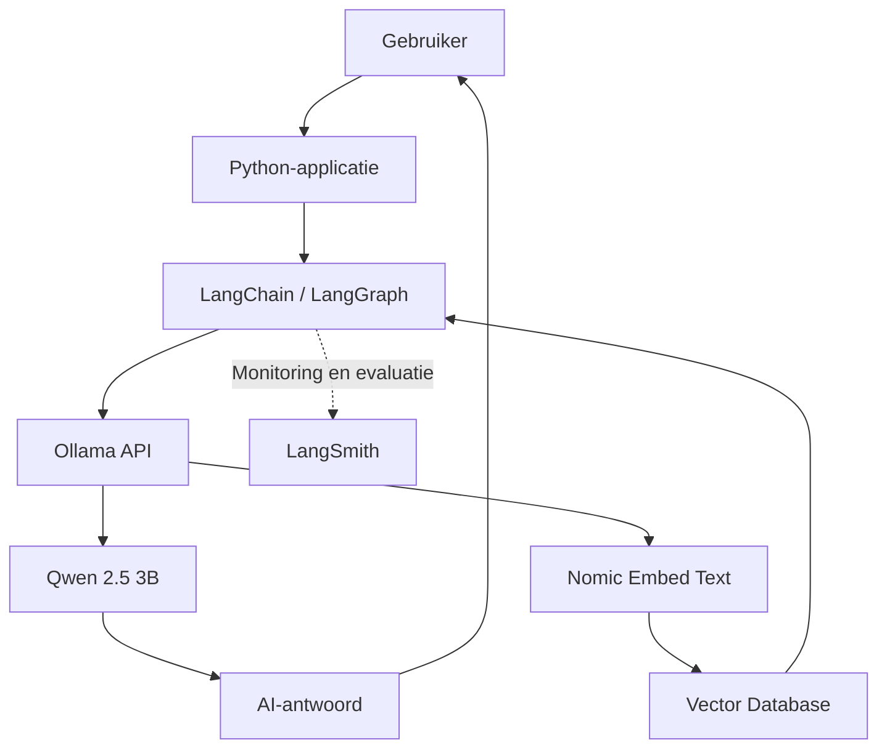

# Lokale AI-omgeving installeren: Ollama, Qwen en Nomic Embed Text


## 1. Doel

In deze handleiding bouwen we een lokale AI-omgeving op een Linux-laptop.

Met deze omgeving kunnen we taalmodellen en embeddingmodellen lokaal uitvoeren. Dit vormt de basis voor het ontwikkelen van AI-toepassingen met:

- LangChain
- LangGraph
- LangSmith
- ChromaDB

Het uiteindelijke doel is het bouwen van een lokale RAG-assistent (Retrieval-Augmented Generation).

## 2. Hardware en omgeving

De installatie is uitgevoerd op de volgende laptop:

| Onderdeel | Specificatie |
|---|---|
| Laptop | Lenovo Legion 5 17ITH6H |
| Processor | Intel Core i7-11800H |
| Werkgeheugen | 16 GB RAM |
| Videokaart | NVIDIA GeForce RTX 3060 Mobile |
| Videogeheugen | 6 GB VRAM |
| Opslag | 1 TB SSD |
| Besturingssysteem | Linux |

Deze hardware is geschikt om met kleinere lokale AI-modellen te experimenteren.

## 3. Overzicht van de gebruikte software

| Software | Functie |
|---|---|
| Ollama | Lokaal uitvoeren en beheren van AI-modellen |
| Qwen 2.5 3B | Taalmodel voor het genereren van antwoorden |
| Nomic Embed Text | Embeddingmodel voor semantisch zoeken |
| LangChain | Bouwen van applicaties met taalmodellen |
| LangGraph | Organiseren van AI-workflows |
| LangSmith | Testen, evalueren en monitoren van AI-toepassingen |
| ChromaDB | Opslaan en doorzoeken van documentvectoren |

## 4. Ollama installeren

Ollama is een lokale AI-server waarmee je taalmodellen op je eigen computer kunt uitvoeren.

### Installatie

Open de Linux-terminal en voer uit:

```bash
curl -fsSL https://ollama.com/install.sh | sh
```

Het installatieprogramma:

- Installeert Ollama.
- Maakt een systeemgebruiker aan.
- Configureert de Ollama-service.
- Start de Ollama-service.
- Controleert of een NVIDIA-GPU beschikbaar is.

### Installatie controleren

```bash
ollama --version
```

Verwacht resultaat:

```text
ollama version is 0.40.6
```

De precieze versie kan inmiddels hoger zijn.

## 5. Qwen 2.5 3B installeren

Qwen 2.5 3B is het taalmodel dat we gebruiken om antwoorden te genereren.

De aanduiding 3B staat voor ongeveer 3 miljard parameters.

### Model downloaden en starten

```bash
ollama run qwen2.5:3b
```

Ollama downloadt het model automatisch als het nog niet aanwezig is.

Na het downloaden kun je rechtstreeks vragen stellen in de terminal.

### Testprompt

```text
Je bent een assistent voor functioneel beheer bij de Nederlandse overheid.

Leg in maximaal 5 zinnen uit wat functioneel beheer inhoudt.

Gebruik eenvoudige taal en geef één praktisch voorbeeld.
```

Qwen ontvangt de prompt en genereert een antwoord:

```text
Functioneel beheer is het onderhouden van een systeem of organisatie in 
een manier die zorgt voor optimale prestaties en effectiviteit. Het is de 
verantwoordelijkheid ervoor te zorgen dat een systeem of organisatie in de 
juiste staat is om effectief en kostgeeftevreden te blijven functioneren. 

Praktisch voorbeeld: In een leefondsen, waar alle projecten en 
activiteiten ondergebracht zijn in een systeem, zou de functioneel beheer 
verantwoordelijk zijn voor zorg dat alle projecten in hun beperde termijn 
en budget gereed zijn en uitgevoerd worden. Dit zorgt ervoor dat het 
leefondsen effectief in de toekomst blijft functioneren en de bestaande funderingen effectief gebruikt.
```


### Model afsluiten

Typ:

```text
/bye
```

Hiermee sluit je de interactieve modelsessie af.

## 6. Nomic Embed Text installeren

Voor een RAG-toepassing hebben we naast een taalmodel ook een embeddingmodel nodig.

Een embeddingmodel zet tekst om in numerieke vectoren.

Deze vectoren maken het mogelijk om documenten te doorzoeken op basis van betekenis in plaats van uitsluitend op exacte woorden.

### Model downloaden

```bash
ollama pull nomic-embed-text
```

Het model wordt lokaal opgeslagen en kan vervolgens door bijvoorbeeld LangChain worden gebruikt.

## 7. Controleren welke modellen geïnstalleerd zijn

Voer het volgende commando uit:

```bash
ollama list
```

Je ziet nu onder andere:

- `qwen2.5:3b`
- `nomic-embed-text`

Hiermee controleer je of beide modellen beschikbaar zijn.

## 8. Architectuur

De lokale AI-omgeving bestaat uit twee modellen met verschillende taken.

### Qwen 2.5 3B

- Ontvangt de prompt.
- Analyseert de beschikbare informatie.
- Genereert een antwoord.

### Nomic Embed Text

- Verwerkt documenten tot vectoren.
- Verwerkt zoekvragen tot vectoren.
- Maakt semantisch zoeken mogelijk.

### Architectuurschema



## 9. Praktijkvoorbeeld: RAG voor functioneel beheer

Een mogelijke toepassing is een AI-assistent die kennisdocumenten over een overheidsapplicatie doorzoekt.

Een gebruiker stelt de vraag:

> Hoe moet ik een incident registreren?

De RAG-toepassing voert de volgende stappen uit:

1. De vraag wordt ontvangen door de Python-applicatie.
2. Nomic Embed Text zet de vraag om in een vector.
3. De vector wordt gebruikt