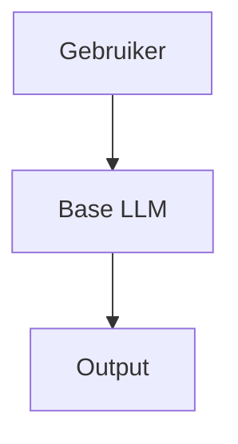
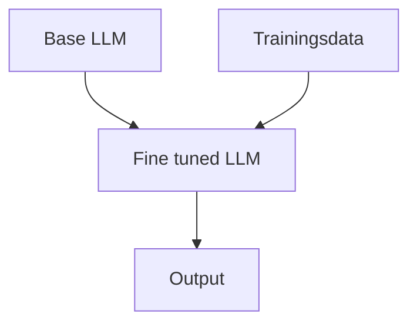
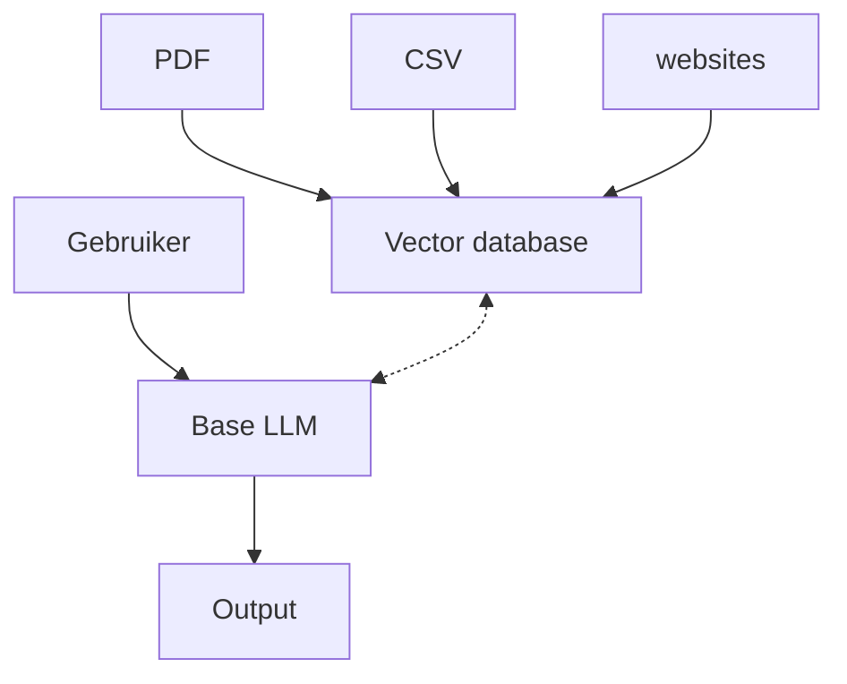
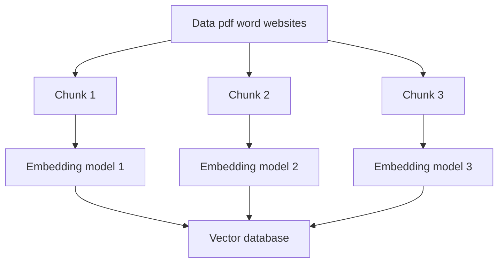

# RAG

RAG staat voor Retrieval Augmentation Generation. Heel kort door de bocht kan je stellen dat je met RAG een LLM toegang geeft tot een 'nieuwe' database waaruit hij informatie kan halen, los van zijn trainingsdata.

## Hoe werkt dat?
Stel: Je gaat naar India. Je stapt een restaurant binnen en  je vraagt daar om een bord hutspot. Er kunnen een aantal dingen gebeuren:

1. Je krijgt het antwoord dat de chef dat niet kan of weet
2. De chef neemt de uitdaging aan en improviseerd wat (wat in de verste verte niet op hutspot lijkt vermoedelijk)
3. Hij loopt naar de boekenkast en zoekt een receptenboek waar het recept in staat

Dit laatste (het receptenboek) is een voorbeeld van RAG. De chef is getraind in de Indiase keuken (dit is dus zijn trainingsdata). In die trainingsdata zit niet de kennis om hutspot te maken. Hij moet zijn kennis dus tijdelijk ergens anders vandaan halen (het receptenboek).

Let wel: Het receptenboek is nu geen deel geworden van de trainingsdata. Na gebruik zet de chef het weer weg om nooit meer te gebruiken. Als hij de kennis daadwerkelijk zou onthouden heet dat geen RAG, maar fine tuning.

Maar wat is nu het verschil tussen Prompt-engineering, fine-tuning en RAG?

## Prompt Engineering, Fine tuning en RAG
De drie termen zijn manieren om een model te 'trainen' of te gebruiken. Wanneer je welke gebruikt hangt af van de vraag. In sommige gevallen is het handig om prompt-engineering toe te passen terwijl andere vraagstukken om fine tuning of RAG vragen. Hieronder volgen de pro's en con's van iedere vorm. 

### Prompt engineering

Prompt engineering wordt gebruikt wanneer je een snel prototype wilt ontwikkelen of als je een algemene niet specifieke vraag hebt. Je geeft een persoon mee (bijvoorbeeld _act as a chef_) vervolgens stel je jouw vraag (bijvoorbeeld _give me a recipe_) en je krijgt een antwoord uit de trainingsdata van het model. Dit betekent:

* Specifieke instructies
* Duidelijke structuren en context meegeven
* Het model en haar data veranderen dus niet

|Pro's|Con's|
|-----|-----|
|Geen techische expertise nodig|Antwoorden worden gelimiteerd tot de trainingsdata|
|Direct resultaat|De antwoorden kunnen inconsistent zijn|
|Geen kosten aan training|Er is vaak sprake van een token-limiet|
|Het werkt met iedere LLM|Je kan geen nieuwe data toevoegen|

### Fine tuning

Fine tuning wordt gebruikt wanneer je een specifiek antwoord wilt genereren en met veel datavolume. Je gebruikt dit is als je een hoge betrouwbaarheid wilt in antwoorden. Je neemt een basis LLM welke je bijtraint met nieuwe data. Deze nieuwe data moet ook verwerkt worden tot nieuwe wegingen. Dit betekent dus dat je:

* De domeinspecifieke data moet verzameld en voorbereid worden
* Het model moet getraind worden
* De training moet leiden tot een gespecialiseerde LLM die bijgehouden moet worden

|Pro's|Con's|
|-----|-----|
|Zeer specialistische kennis in het model|Duur|
|Consistente antwoorden|Je hebt LLM specialisten nodig|
|Geen prompt-engineering nodig|Je moet iedere keer het model bijtrainen bij updates|
|Het werkt goed voor specifieke domeinen (en domeinkennis)||

### RAG
RAG hangt een beetje tussen prompt engineering en fine tuning in. We nemen een basis LLM, maar die laten we communiceren met een vector database met daarin onze belangrijke documenten. We verrijken de trainingsdata niet, we laten de LLM via API's of vector databases kijken in andere bronnen (anders dan zijn eigen trainingsdata). Hiervoor moet je dus:

* Documenten opslaan in een vector database
* Een mogelijkheid hebben om die database met queries te bevragen

De vector database zorgt voor een context die de basis LLM gebruikt om zijn output te genereren.

|Pro's|Con's|
|-----|-----|
|De data is altijd up to date|De infrastructuur (vector databases) moet goed opgezet worden|
|Geen training noodzakelijk|De kwaliteit van de data in de database bepaalt direct de kwaliteit van de output|
|Kosten/baten zijn goed|Je loopt kans dat je uit de context window loopt|
|Hoge betrouwbaarheid|
|Je kan gevoelige informatie ontsluiten omdat het in een 'eigen' vector database staat|

## Core components of RAG

1. Document Ingestion Phase
2. Query Processing Phase
3. Generation Phase

### Document Ingestion and preprocessing
Chunks vanwege context size
Embedding model 0.16, 0.15 etc (zoals Huggingface en OpenAI) 
Als het in de vector database staat kan je simularity search, Euclidic search en Cosine search doen.

Bekende vector database zijn Pinecone, Chromadb, FAISS en datastore.

