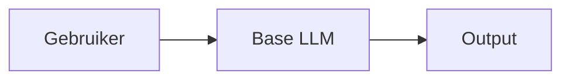
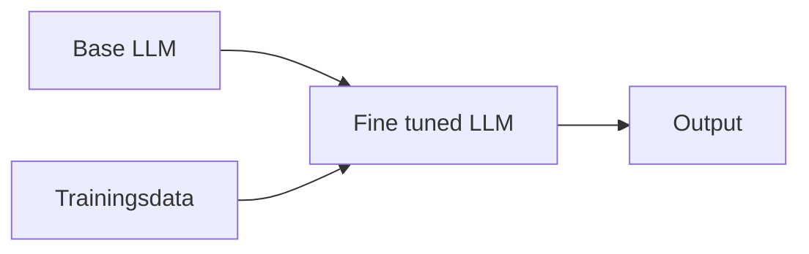
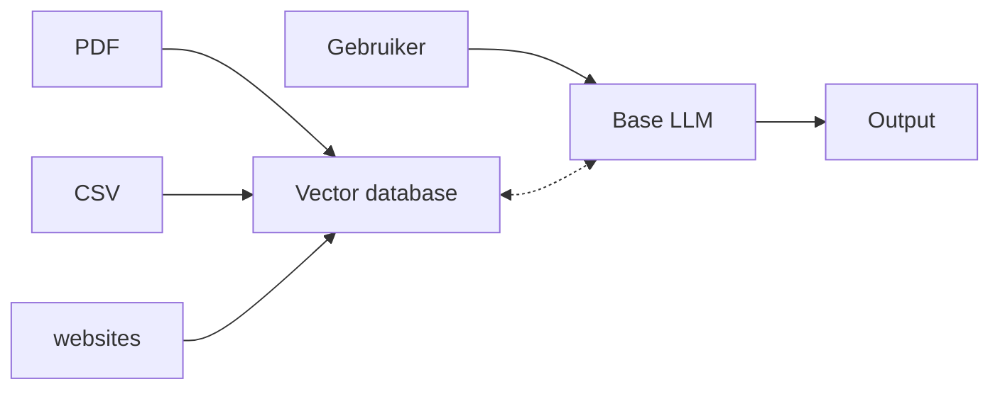
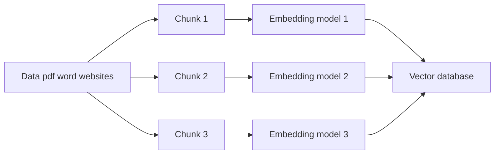
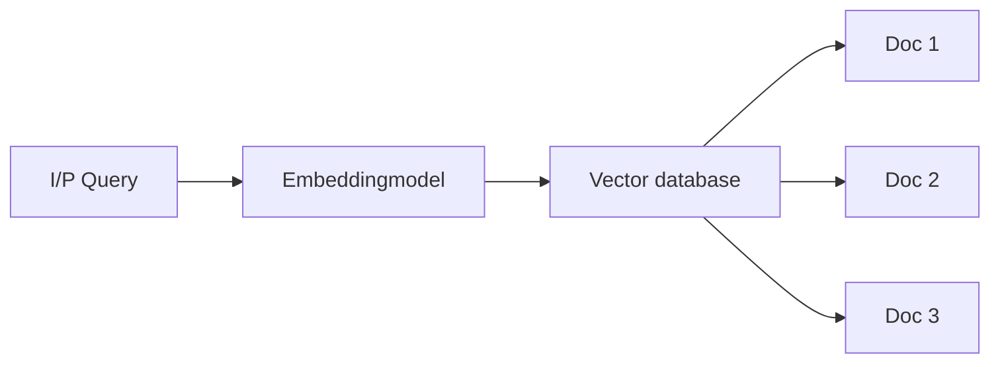
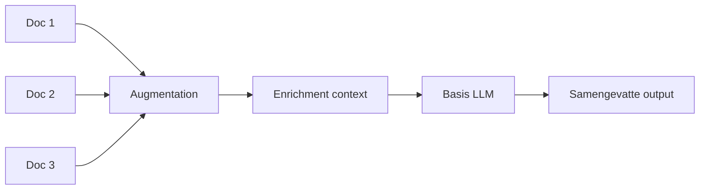

# RAG

RAG staat voor Retrieval Augmentation Generation. Heel kort door de bocht kan je stellen dat je met RAG een LLM toegang geeft tot een 'nieuwe' database waaruit hij informatie kan halen, los van zijn trainingsdata.

## Hoe werkt dat?

Stel: Je gaat naar India. Je stapt een restaurant binnen en  je vraagt daar om een bord hutspot. Er kunnen een aantal dingen gebeuren:

1. Je krijgt het antwoord dat de chef dat niet kan of weet
2. De chef neemt de uitdaging aan en improviseerd wat (wat in de verste verte niet op hutspot lijkt vermoedelijk)
3. Hij loopt naar de boekenkast en zoekt een receptenboek waar het recept in staat

Dit laatste (het receptenboek) is een voorbeeld van RAG. De chef is getraind in de Indiase keuken (dit is dus zijn trainingsdata). In die trainingsdata zit niet de kennis om hutspot te maken. Hij moet zijn kennis dus tijdelijk ergens anders vandaan halen (het receptenboek).

Let wel: Het receptenboek is nu geen deel geworden van de trainingsdata. Na gebruik zet de chef het weer weg om nooit meer te gebruiken. Als hij de kennis daadwerkelijk zou onthouden heet dat geen RAG, maar fine tuning.

Maar wat is nu het verschil tussen Prompt-engineering, fine-tuning en RAG?

## Prompt Engineering, Fine tuning en RAG

De drie termen zijn manieren om een model te 'trainen' of te gebruiken. Wanneer je welke gebruikt hangt af van de vraag. In sommige gevallen is het handig om prompt-engineering toe te passen terwijl andere vraagstukken om fine tuning of RAG vragen. Hieronder volgen de pro's en con's van iedere vorm.

### Prompt engineering

Prompt engineering wordt gebruikt wanneer je een snel prototype wilt ontwikkelen of als je een algemene niet specifieke vraag hebt. Je geeft een persoon mee (bijvoorbeeld _act as a chef_) vervolgens stel je jouw vraag (bijvoorbeeld _give me a recipe_) en je krijgt een antwoord uit de trainingsdata van het model. Dit betekent:

* Specifieke instructies
* Duidelijke structuren en context meegeven
* Het model en haar data veranderen dus niet



|Pro's|Con's|
|-----|-----|
|Geen techische expertise nodig|Antwoorden worden gelimiteerd tot de trainingsdata|
|Direct resultaat|De antwoorden kunnen inconsistent zijn|
|Geen kosten aan training|Er is vaak sprake van een token-limiet|
|Het werkt met iedere LLM|Je kan geen nieuwe data toevoegen|

### Fine tuning

Fine tuning wordt gebruikt wanneer je een specifiek antwoord wilt genereren en met veel datavolume. Je gebruikt dit is als je een hoge betrouwbaarheid wilt in antwoorden. Je neemt een basis LLM welke je bijtraint met nieuwe data. Deze nieuwe data moet ook verwerkt worden tot nieuwe wegingen. Dit betekent dus dat je:

* De domeinspecifieke data moet verzameld en voorbereid worden
* Het model moet getraind worden
* De training moet leiden tot een gespecialiseerde LLM die bijgehouden moet worden



|Pro's|Con's|
|-----|-----|
|Zeer specialistische kennis in het model|Duur|
|Consistente antwoorden|Je hebt LLM specialisten nodig|
|Geen prompt-engineering nodig|Je moet iedere keer het model bijtrainen bij updates|
|Het werkt goed voor specifieke domeinen (en domeinkennis)||

### RAG

RAG hangt een beetje tussen prompt engineering en fine tuning in. We nemen een basis LLM, maar die laten we communiceren met een vector database met daarin onze belangrijke documenten. We verrijken de trainingsdata niet, we laten de LLM via API's of vector databases kijken in andere bronnen (anders dan zijn eigen trainingsdata). Hiervoor moet je dus:

* Documenten opslaan in een vector database
* Een mogelijkheid hebben om die database met queries te bevragen



De vector database zorgt voor een context die de basis LLM gebruikt om zijn output te genereren.

|Pro's|Con's|
|-----|-----|
|De data is altijd up to date|De infrastructuur (vector databases) moet goed opgezet worden|
|Geen training noodzakelijk|De kwaliteit van de data in de database bepaalt direct de kwaliteit van de output|
|Kosten/baten zijn goed|Je loopt kans dat je uit de context window loopt|
|Hoge betrouwbaarheid||
|Je kan gevoelige informatie ontsluiten omdat het in een 'eigen' vector database staat||

## Core components of RAG

1. Document Ingestion Phase
2. Query Processing Phase
3. Generation Phase

### Document Ingestion and preprocessing

Voordat we de data in een vector database kunnen opnemen, moeten we de data klaar maken. Dat betekent eerst opknippen en dan omzetten naar `chuncks`. We verdiepen ons eerst iets meer in embeddingmodellen en daarna in chuncks. Dit is handiger omdat we dan beter met voorbeelden kunnen werken.

#### Embeddingmodelen

Het omzetten van data naar vectoren (die opgeslagen kunnen worden in een vector database) gaat niet zozeer om opslag, maar om context. We gaan proberen om informatie terug te vinden op basis van betekenis in plaats van zoekwoorden. Zoeken op woorden is namelijk niet hetzelfde als zoeken op betekenis. Een voorbeeld:

We hebben een pdf waar het volgende instaat:

> _Een inwoner kan bij de gemeente een vergunning aanvragen om in een betaald parkeergebied te parkeren._

De gebruiker vraagt aan het LLM:

> _Hoe kan ik mijn auto in mijn wijk parkeren zonder steeds te betalen?_

Een traditionele zoekmachine zoekt naar termen die uit de vraag komen, maar met onze pdf in het achterhoofd zien we de volgende verschillen:

|PDF|Gebruikersvraag|
|----|----|
|Vergunning aanvragen|Hoe kan ik parkeren?|
|Betaald parkeergebied|Zonder steeds te betalen|
|Inwoner|Mijn wijk|

Voor ons mensen is het duidelijk dat zowel de pdf als de gebruikersvraag 'bij elkaar horen'. Dit is voor een computer lastiger. De computer begrijpt de overeenkomsten niet automatisch. De oplossing hiervoor zijn embeddings.

#### Vectorruimte

Een embeddingmodel is een model dat tekst omzet naar een reeks getallen. Bijvoorbeeld:

|Tekst|Nummerieke weergave|
|-----|-----|
|Hoe kan ik mijn auto in mijn wijk parkeren zonder steeds te betalen?|`[0.21, 0.83, -0.14, 0.55, 0.92, ...]`|
|Een inwoner kan bij de gemeente een vergunning aanvragen om in een betaald parkeergebied te parkeren.|`[0.19, 0.79, -0.11, 0.51, 0.89, ...]`|

Het embeddingmodel probeert de betekenis van tekst vast te leggen in een nummerieke representatie van de term. Teksten met een vergelijkbare betekenissen krijgen vaak vectors die dicht bij elkaar liggen in de vectorruimte. Dit heet semantische overeenkomst.

Iedere tekst heeft in de vectorruimte zijn eigen plek. Vergelijkbare teksten liggen dicht bij elkaar. Dus: Onze pfd over parkeervergunningen liggen dicht bij documenten over parkeren, maar heel ver weg van documenten over kattenoverlast. Hoe meer de betekenis van twee teksten overeenkomen, hoe dichter hun vectors doorgaans bij elkaar liggen.

#### Chunks

Nu we weten dat we termen proberen te vatten in een vector (diens nummerieke representatie), weet je vermoedelijk ook dat een bestand van 100 pagina's omzetten in een vector geen slim idee is. Je kan de tekst beter opknippen in meerdere brokken (`chuncks`). Dus als we het beleidsstuk _parkeervergunningen_ nemen van een gemeente, zou het zo maar kunnen zijn dat dit stuk als volgt opgeknipt wordt:

|Chunk|Inhoud|
|----|----|
|1|Aanvragen parkeervergunning|
|2|Kosten parkeervergunning|
|3|Verlengen parkeervergunning|
|4|Bezwaar maken tegen afwijzing|

Iedere chunk krijgt zijn eigen embedding. Hierdoor kunnen we veel gerichter zoeken. Als iemand vraagt naar de kosten van een parkeervergunning, kunnen we specifiek de chunk over de kosten terugvinden. Het zoeken op betekenis heet semantisch zoeken.

#### Flowchart

Als we bovenstaande samen zouden vatten in een flowchart, ziet deze er als volgt uit:



### Query processing

Nu we de data hebben klaar gemaakt en opgeslagen in de vector database, kunnen we deze database bevragen. Misschien kan je al bedenken dat de gebruikersvraag dan ook omgezet moet worden naar vectoren. We zagen het al eerder in ons voorbeeld om aan te tonen dat het beleidsstuk en de gebruikersvraag dichtbij elkaar lagen in de vectorruimte. We moeten net als bij de brondata, de gebruikersvraag omzetten in vectoren.

Maar de vector database geeft geen direct antwoord. Het enige dat de vector teruggeeft is context. Hij geeft de 'documenten' terug die dichtbij de vraag liggen (in de vectorruimte). De documenten die teruggegeven worden, heten de retrieved results. Deze geven context.



Het teruggeven van de documenten heet retreival.

### Generation

De generation fase is relatief simpel in verhouding met eerdere fases. In deze stap. We hebben via de query processing 3 documenten gekregen die dichtbij de gebruikersvraag lagen.

Nu we de context hebben moeten we deze verrijken (augmentation). Hier komt de gebruikersvraag er bijvoorbeeld weer bij. Dus: De oorspronkelijke vraag is nu verrijkt met relevante informatie uit de vectordatabase. Dit is augmentation. Nu we de informatie hebben, kunnen we deze nogmaals verrijken. Dit doen we met meta-data. De informatie komt uit document 1, 2 en 3 maar we hebben ook nog metadata van het document. Bijvoorbeeld:

```json
{
  "content": "Een bewoner kan een aanvraag voor een vergunning doen via het omgevingsloket van de gemeente.",
  "metadata": {
    "document_name": "Procedure parkeervergunning",
    "document_type": "Beleidsstuk",
    "department": "VTH",
    "version": "2.1",
    "publication_date": "2026-01-01",
    "source": "VTH-handboek"
  }
}
```
Dus met deze metadata kunnen we de gebruiker meer informatie geven bij het geven van een antwoord (enrichment). We weten nu de inhoud, de vraag en waar de inhoud vandaan komt. Dit ziet er als volgt uit:



Dus als we dan naar een voorbeeld van de vraag en het antwoord kijken zie je ongeveer het volgende:

```text
Je bent een assistent van een overheidsorganisatie.

Beantwoord de vraag van de gebruiker uitsluitend
op basis van de onderstaande context.

GEBRUIKERSVRAAG:
Hoe kan ik mijn auto in mijn wijk parkeren zonder steeds te betalen?

CONTEXT:

Document 1:
Naam: Procedure parkeervergunning
Afdeling: VTH
Versie: 2.1

Inhoud:
Een bewoner kan een aanvraag voor een vergunning doen via het omgevingsloket van de gemeente.

Document 2:
Naam: Voorwaarden parkeervergunning
Afdeling: VTH

Inhoud:
Een parkeervergunning is gekoppeld aan een woning. In die woning moet minimaal 1 persoon op het adres ingeschreven zijn.

ANTWOORD:
Je kan een vergunning aanvragen bij het omgevingsloket van de gemeente. Iemand in jouw huishouden moet wel ingeschreven zijn op een adres in de gemeente. De vergunning is gekoppeld aan de woning.

```
